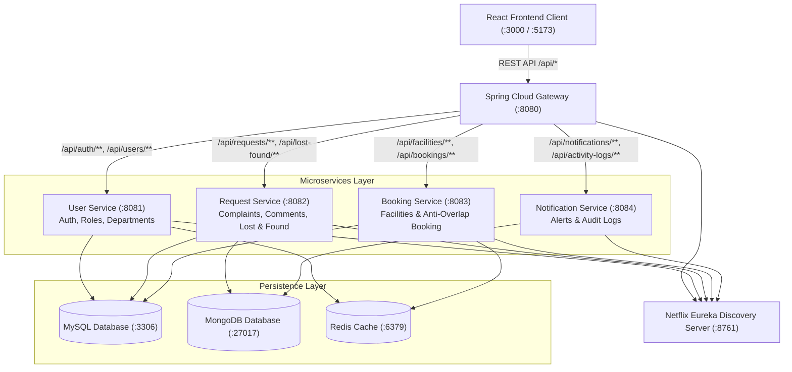

# CampusConnect – Smart University Service Management System
> Enterprise-grade, full-stack microservices university service operations platform built with Spring Boot 3.x, React 18, Spring Cloud Gateway, Netflix Eureka, MySQL, MongoDB, and Redis.


---

## 1. Project Overview & Features

**CampusConnect** is a centralized university service and facility operations platform designed for universities, colleges, students, maintenance departments, and campus administrators.

### Core Capabilities by Role:

| Role | Key Capabilities |
|---|---|
| **STUDENT** | Submit complaints & requests (`REQ-2026-XXXX`), track lifecycle progress, book campus facilities (seminar halls, computing labs, study rooms) with atomic double-booking prevention, report & search lost/found items, receive real-time alerts, communicate with assigned staff via comment feeds. |
| **STAFF** | Workboard of assigned departmental requests, status lifecycle updates (`SUBMITTED` $\to$ `ASSIGNED` $\to$ `IN_PROGRESS` $\to$ `RESOLVED`), mandatory resolution documentation, facility schedules. |
| **ADMIN** | Executive dashboard with analytics & KPIs (Recharts), ticket assignment & priority override, student/staff user management, department administration, facility catalog management, lost & found moderation, and system audit logs. |

---

## 2. Technology Stack

### Frontend
- **Framework**: React 18 with Vite
- **Styling**: Tailwind CSS (Professional SaaS palette: Deep Navy `#0f172a`, Indigo `#4f46e5`, Emerald `#10b981`)
- **Routing**: React Router DOM v6 with role-based protected routes
- **HTTP Client**: Axios with automatic JWT interceptors and 401 handling
- **Visualizations**: Recharts (Bar charts, line charts, pie charts)
- **Icons**: Lucide React
- **Forms**: React Hook Form with validation

### Backend Microservices
- **Runtimes**: Java 17 LTS / JDK 24, Spring Boot 3.3.4
- **Security**: Spring Security 6 with JWT (io.jsonwebtoken JJWT 0.12.5) and BCrypt password encryption
- **Data & ORM**: Spring Data JPA, Hibernate, Spring Data MongoDB
- **Caching**: Redis Cache (`@Cacheable`, `@CacheEvict`)
- **API Documentation**: Springdoc OpenAPI 3 / Swagger UI
- **Service Discovery**: Netflix Eureka Discovery Server
- **API Gateway**: Spring Cloud Gateway with reactive CORS and claim injection

### Persistence & Storage
- **MySQL 8.0**: Primary ACID relational database for Users, Departments, Service Requests, Facilities, and Bookings.
- **MongoDB 6.0**: Flexible document database for request comments, in-app notifications, and audit activity streams.
- **Redis 7.0**: High-speed memory cache for Admin dashboard statistics, department rosters, and facility lists.

---

## 3. Microservices Architecture & Port Mapping



| Service | Port | Primary Database | Swagger / OpenAPI |
|---|---|---|---|
| **Eureka Discovery Server** | `8761` | N/A | http://localhost:8761 |
| **API Gateway** | `8080` | N/A | http://localhost:8080/actuator/gateway/routes |
| **User Service** | `8081` | MySQL (`campusconnect_user`) | http://localhost:8081/swagger-ui.html |
| **Request Service** | `8082` | MySQL & MongoDB | http://localhost:8082/swagger-ui.html |
| **Booking Service** | `8083` | MySQL (`campusconnect_booking`) | http://localhost:8083/swagger-ui.html |
| **Notification Service** | `8084` | MongoDB (`campusconnect_notifications`) | http://localhost:8084/swagger-ui.html |
| **React Frontend Client** | `3000` (Docker) / `5173` (Vite dev) | N/A | http://localhost:3000 |

---

## 4. Default Demo Seed Credentials

The database auto-initializes with realistic sample users. A convenient **"1-Click Demo Evaluation"** button bar is also available on the Login screen!

| Role | Email | Password | Department / Description |
|---|---|---|---|
| **ADMIN** | `admin@campusconnect.edu` | `Admin@123` | System Administrator (Dr. Eleanor Vance) |
| **STAFF** | `staff.it@campusconnect.edu` | `Staff@123` | IT Support Lead (Marcus Chen) |
| **STAFF** | `staff.maintenance@campusconnect.edu` | `Staff@123` | Campus Maintenance Supervisor (Robert Miller) |
| **STAFF** | `staff.electrical@campusconnect.edu` | `Staff@123` | Chief Electrician (Aisha Patel) |
| **STUDENT** | `student1@campusconnect.edu` | `Student@123` | Alex Rivera |
| **STUDENT** | `student2@campusconnect.edu` | `Student@123` | Sophia Martinez |
| **STUDENT** | `student3@campusconnect.edu` to `student10@...` | `Student@123` | Students 3 through 10 |

---

## 5. Quick Start Execution Guide

### Option A: Complete One-Command Launch (Docker Compose)
Prerequisites: Docker and Docker Compose installed.

```bash
# 1. Clone or navigate to the repository
cd c:\Users\admin\Full_Stack_Project

# 2. Start all microservices, databases, Redis, Gateway, and Frontend
docker compose up --build -d

# 3. View status of all running containers
docker compose ps
```
The application will be live at:
- Frontend: **http://localhost:3000**
- API Gateway: **http://localhost:8080**
- Eureka Dashboard: **http://localhost:8761**

---

### Option B: Local Developer Launch

#### 1. Start Infrastructure
Run MySQL (3306), MongoDB (27017), and Redis (6379), or run them via Docker:
```bash
docker compose up -d mysql mongodb redis
```

#### 2. Start Microservices in Order
```bash
# Terminal 1: Discovery Server
cd backend/discovery-server
mvn spring-boot:run

# Terminal 2: API Gateway
cd backend/api-gateway
mvn spring-boot:run

# Terminal 3: User Service
cd backend/user-service
mvn spring-boot:run

# Terminal 4: Request Service
cd backend/request-service
mvn spring-boot:run

# Terminal 5: Booking Service
cd backend/booking-service
mvn spring-boot:run

# Terminal 6: Notification Service
cd backend/notification-service
mvn spring-boot:run
```

#### 3. Start Frontend Client
```bash
cd frontend
npm install
npm run dev
```
Open **http://localhost:5173** in your browser.

---

## 6. Testing

### Run Backend Unit & Integration Tests (JUnit 5, Mockito, MockMvc)
```bash
cd backend
mvn test
```
Tests included:
- `AuthServiceTest`: User registration and existing account validation.
- `ServiceRequestServiceTest`: Request creation and mandatory resolution notes check.
- `BookingServiceTest`: Anti-overlap validation throwing `OverlappingBookingException`.
- `NotificationServiceTest`: Alert generation and unread counter badge calculation.

### Run Frontend Tests
```bash
cd frontend
npm test
```

---

## 7. Anti-Double-Booking Architecture

A critical highlight of CampusConnect is mathematical overlap prevention for campus facilities:
- When a student attempts to reserve a slot $[S_{\text{new}}, E_{\text{new}}]$, the backend executes an atomic check:
  $$\text{COUNT}(b) \quad \text{where} \quad b.startTime < E_{\text{new}} \quad \text{AND} \quad b.endTime > S_{\text{new}}$$
- If $\text{COUNT} > 0$, the request is rejected with `409 CONFLICT` and an explanatory message.
- Overlap checks are executed inside a serializable database transaction to guarantee zero race conditions.

---

## 8. Continuous Integration & Delivery (CI/CD)

The repository includes a production-style GitHub Actions pipeline (`.github/workflows/ci.yml`) that triggers on every push and pull request:
1. **Frontend CI**: Dependency caching, linting, Vitest suite, and Vite production bundle compilation.
2. **Backend CI**: JDK 17 setup, Maven dependency caching, JUnit 5 & Mockito test suite execution, and JAR packaging.
3. **Containerization**: Docker Compose configuration validation and multi-service image build testing.

---

## 9. Authors & Academic Acknowledgement
Developed for university-level **Full Stack Development II (FSD-II)** capstone demonstration, adhering to modern software engineering standards, cloud-native microservices design, and clean architecture principles.
