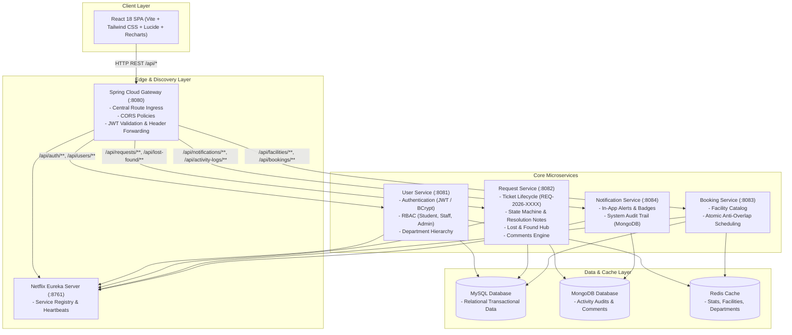

# CampusConnect: System Architecture Specification

## 1. Architectural Philosophy
CampusConnect is structured as a cloud-native microservices application built with Spring Boot 3.x, Spring Cloud Gateway, Netflix Eureka, React 18, MySQL, MongoDB, and Redis.



---

## 2. API Gateway & Security Flow

1. **Authentication Token Flow**:
   - The user authenticates at `/api/auth/login`.
   - `UserService` generates a signed HMAC-SHA256 JWT containing `userId`, `email`, and `role`.
   - The client stores the token in `localStorage` and includes it in the `Authorization: Bearer <token>` header on subsequent requests.
2. **Gateway Pre-Filtering & Claim Enrichment**:
   - `JwtAuthFilter` in the API Gateway intercepts incoming requests.
   - For valid tokens, the Gateway decodes claims and appends enrichment headers:
     - `X-User-Id`: The user's database ID.
     - `X-User-Role`: The user's role (`STUDENT`, `STAFF`, `ADMIN`).
     - `X-User-Email`: The user's university email.
   - Downstream services read these trusted headers or re-validate the token for defense-in-depth.

---

## 3. Database Ownership & Isolation
Each microservice owns its business domain to ensure loose coupling:
- **User Service**: Controls `users` and `departments`.
- **Request Service**: Controls `service_requests`, `request_history`, `lost_found_items`, and MongoDB `request_comments`.
- **Booking Service**: Controls `facilities` and `bookings`.
- **Notification Service**: Controls MongoDB `notifications` and `activity_logs`.

---

## 4. Facility Booking Concurrency Control
To prevent overlapping facility reservations, the Booking Service employs:
1. **Time-Window Math**:
   An overlap between an existing interval `[S_1, E_1]` and a requested interval `[S_2, E_2]` occurs if and only if:
   $$S_1 < E_2 \quad \text{AND} \quad E_1 > S_2$$
2. **Database Query with Active Filter**:
   ```sql
   SELECT COUNT(b) FROM Booking b
   WHERE b.facilityId = :facilityId
     AND b.status IN ('CONFIRMED', 'PENDING_APPROVAL')
     AND (b.startTime < :endTime AND b.endTime > :startTime);
   ```
3. **Transaction Isolation**:
   The booking creation method is executed with `Isolation.SERIALIZABLE` or synchronized transactional locking, throwing an `OverlappingBookingException` (HTTP 409 Conflict) if any collision is found.
